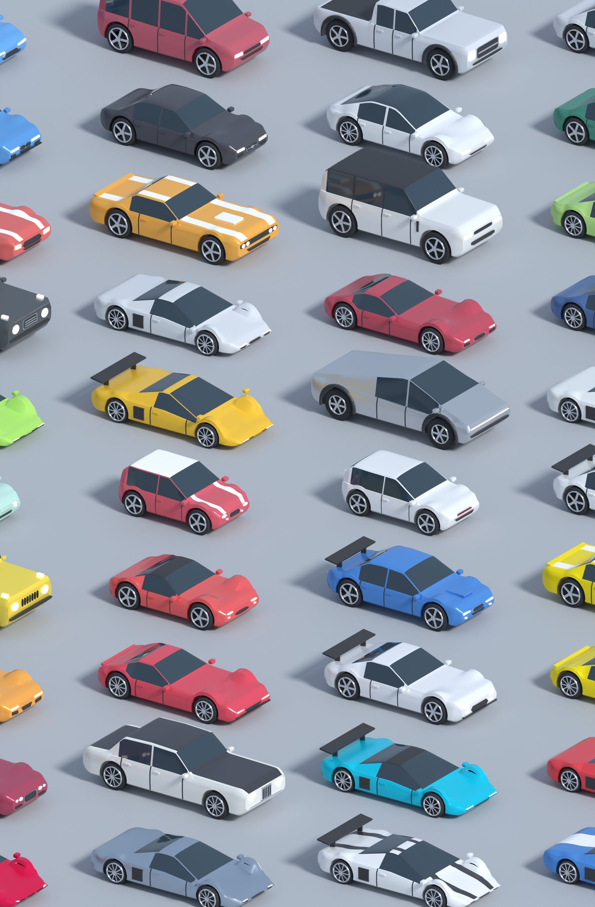
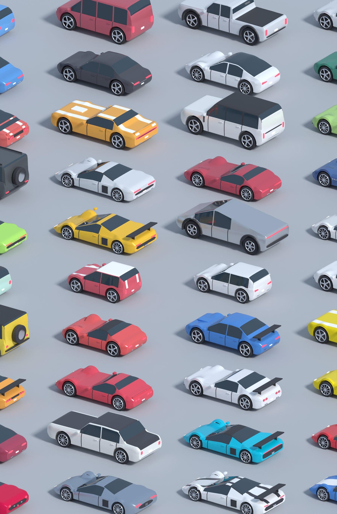
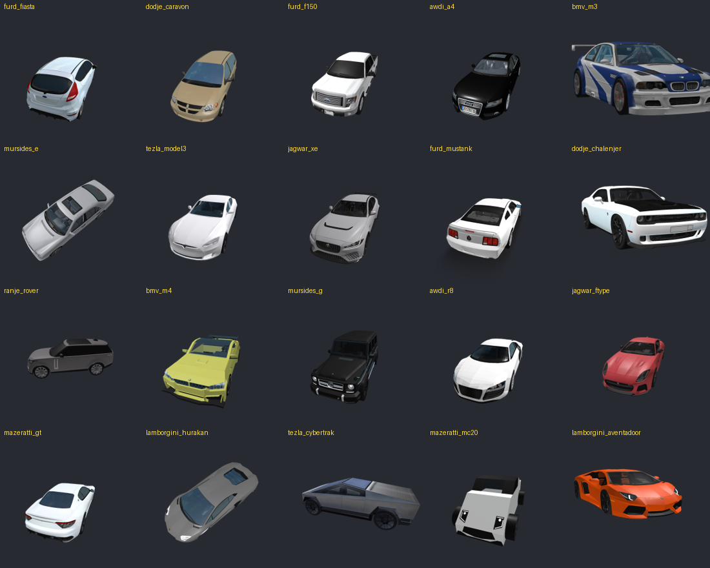
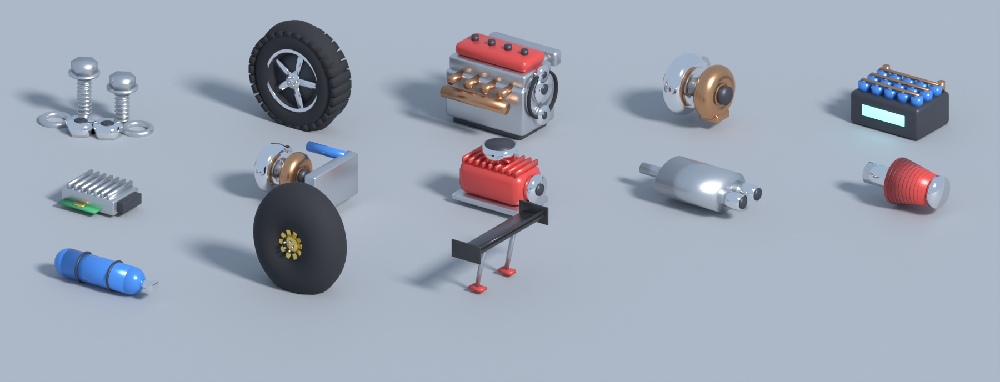

# CAR HUNTERS

Roblox-игра: бегай по опасным дорогам, собирай детали, бросай их в ловушку в гараже — получай машины.

## Что внутри

| Путь | Что это |
|---|---|
| `CarHunters.rbxlx` | **Готовый плейс** — открыть в Roblox Studio |
| `src/` | Все скрипты (структура = дерево Explorer). Источник правды для кода |
| `base/CarHunters_original.rbxlx` | Исходный плейс (до изменений) |
| `tools/build_place.py` | Собирает `CarHunters.rbxlx` из `base/` + `src/` |
| `blender/make_cars.py`, `blender/make_props.py`, `blender/make_parts.py` | Генераторы 3D-моделей в Blender |
| `assets/cars/*.fbx`, `assets/props/props.fbx`, `assets/parts/parts.fbx` | Готовые модели машин, пропсов и деталей |
| `tools/econ_sim.py`, `docs/ECONOMY.md` | Симулятор экономики и описание баланса/петель |
| `docs/renders/` | Рендеры моделей из Blender |
| `docs/figma/` | Скриншот макета UI |

Пересборка плейса после правки скриптов: `python3 tools/build_place.py`.

## UI (Figma → Luau)

Макет: **https://www.figma.com/design/J1YivVRVzpzEBhV6d5qPe4** (HUD, телепорт, выбор приманки, получение машины, экран WRECKED, мобильная раскладка, UI-кит).
Код: `src/StarterPlayer/StarterPlayerScripts/Client/UI.lua`.

- Шрифты: **Luckiest Guy** (заголовки, кнопки) + **Fredoka One** (текст).
- Палитра: жёлтый / оранжевый / красный / зелёный / голубой, чёрная обводка. **Фиолетового нет** (редкость Epic теперь красно-розовая).
- Минимум кнопок: справа 3 большие — **TELEPORT**, **GARAGE**, **CARS**. Кнопка **THROW!** появляется только у своей ловушки.
- Телепорт: «Мой гараж» + все открытые районы; закрытые районы открываются прямо в этом окне. С добычей в рюкзаке телепорт домой запрещён — её надо донести ногами (иначе пропадает риск).

## Карта (v3)

- Компактная: 380 × 1386 studs, гаражи 2×4 ближе к центру, районы по ~230 studs.
- **Без неона.** Светятся только настоящие источники света (фонари, лампы в гаражах), декор — пластик, металл, кирпич, стекло. Ночной район — вывески и тёплые фонари вместо светящихся палок.
- **Беговые дорожки:** пара тёмно-серых полос с белыми стрелками — одна к районам, другая обратно к гаражам. Ускорение (18 → 48) только при беге по стрелке. Полосы идут по центральной аллее, от каждого гаража к центру и через кварталы, дороги не пересекают.
- **Гаражи:** кирпичная стена с рольставнями, навес на стальных колоннах, разметка мест, подъёмник-ловушка с магнитным краном, ворота «VEHICLE IN», ящик-терминал, верстак, бочки, покрышки.
- **В центре площади:** магазин **PIT STOP** с NPC-механиком и лавка **GOLDEN MAGNATE** с NPC-магнатом (цилиндр, трость, подкидывает монету).
- Доска контрактов, табло лидеров, витрина двух легендарных машин.

## Забег за деталями, магазин, донат

Подробно — `docs/GAMEPLAY.md`. Кратко: ящики на дорогах, серия ×1.5/×2/×3, Hot Drop каждые ~80 с, 3 контракта, 8 улучшений в Pit Stop (кроссовки, рюкзак, магнит, подушка безопасности, сканер, удачливая ловушка, турбо-гараж, быстрый старт).

**Донат (Golden Magnate):** 13 товаров (x2 доход 30 мин, x2 удача 15 мин, «Sure Shot», «Call a Hot Drop», «Insurance», 4 пачки денег, 3 ящика деталей, +3 парковки) и 6 геймпассов (VIP, Huge Backpack, Mega Magnet, эксклюзивная Golden Magnat GT, Contract Boss, Fast Trap). Покупки обрабатываются идемпотентно (`ProcessReceipt`, журнал PurchaseId в профиле).
- В Studio, пока товары не созданы (ID = 0 в `ProductIds.lua`), покупка симулируется — можно тестировать.
- Создать товары и записать ID: `python3 tools/roblox_open_cloud.py products --universe <ID игры>` (нужен Open Cloud ключ).

**Маркеры и мини-карта:** значки над гаражом, магазином, магнатом, доской контрактов, Hot Drop и редкими деталями (со сканером); стрелка у края экрана к цели (Hot Drop или гараж, если несёшь добычу). Мини-карта в правом верхнем углу, тап — вся карта.

## Звуки (ElevenLabs)

23 звука в `assets/sounds/` (клики, бросок, магнит, reveal, падение машины, выезд, подбор, банк, серия, касса, сирена Hot Drop, авария, «WRECKED», подушка, телепорт, фанфары). Загрузка в Roblox: `python3 tools/roblox_open_cloud.py sounds --creator-user <ваш UserId>` → ID пишутся в `SoundIds.lua`. Пока ID = 0, играют встроенные звуки Roblox.

## Анимации

- **Бросок и выпадение:** плавная камера, деталь со шлейфом летит на подъёмник, искры и пыль, магнит опускается и заряжается (свет цвета редкости, искры, глубина резкости), вспышка цветокоррекции, машина падает на подъёмник с отскоком подвески и пылью, контур цвета редкости, выезд на парковку. Легендарка — золотой салют, Epic+ — надпись.
- **Смерть:** ragdoll-тело, стоп-кадр с контрастом, осколки стекла и пыль, серый фильтр, «WRECKED!», список потерь, кран-камера, отсчёт.
- **Мелкие:** всплывающее «+N» при подборе, иконки летят в HUD при сдаче, дождь монет при донате, подушка безопасности.
- Убраны источники визуальных багов: полупрозрачные неоновые цилиндры, полосы-глитчи поверх экрана, RGB-двоение текста, z-fighting разметки.

## Дым из глушителя (`ExhaustFx.lua`)

| Редкость | Эффект |
|---|---|
| Common | тонкий серый дым |
| Uncommon | плотнее, зеленоватый |
| Rare | голубой дым + искры, 2 трубы |
| Epic | красное пламя + тёмный дым + искры, хлопки |
| Legendary | золотое пламя, светящийся дым, искры, свет, хлопки |

## 3D-модели из Blender — один ручной шаг

Модели строит `blender/make_cars.py`: кузов по реальным пропорциям и силуэту каждого типа машины, остекление со стойками, линии дверей, арки, литые диски с суппортами, узнаваемые «лица» — формы решёток, фар и фонарей. 40 коллекционных (~10k треугольников) и 11 машин трафика в облегчённом LOD (~6.5k), построенных на тех же кузовах.

**Про права.** Машины *вдохновлены* настоящими: узнаются по силуэту и общим чертам, но на них нет логотипов, эмблем и настоящих названий. Названия пародийные и лежат в одном месте — таблица `list` в `src/ReplicatedStorage/Shared/CarConfig.lua`, поле `name`.

| Редкость | Машины |
|---|---|
| Common | Furd Fiasta · Dodje Caravon · Furd F-One-Fifty · Awdi A-Four |
| Uncommon | BMV M-Tree · Mursides E-Klass · Tezla Model Tree · Jagwar XE |
| Rare | Furd Mustank · Dodje Chalenjer · Ranje Rover · BMV M-Fore |
| Epic | Mursides G-Vagon · Awdi R-Ate · Jagwar F-Tipe · Mazeratti GranTurizmo |
| Legendary | Lamborgini Hurakan · Tezla Cybertrak · Mazeratti MC-Twenty · Lamborgini Aventadoor |

Вторая волна (ещё 20, итого 40 машин — по 8 на редкость):

| Редкость | Машины |
|---|---|
| Common | Fiyat Five-Hundo · Mini Kooper · Volksvagen Gulf GTI · Hunda Civik Type-Arr |
| Uncommon | Jeap Rangler · Mazta Miyata · Subaroo WRX · Chevy Kamaro |
| Rare | Toyoda Supera · Chevy Korvette · Nisan GT-Arr · Porshe Nine-Eleven |
| Epic | Bentli Kontinental · Rolz-Roice Fantom · MakLaren P-One · Ferarri Four-Ate-Ate |
| Legendary | Ferarri LaFerarri · Pagany Wyra · Konigseg Agera · Bugati Shiron |




Roblox не позволяет вшить меши в `.rbxlx` без загрузки в ваш аккаунт, поэтому импорт делаете вы (бесплатно):

1. Studio → **Home → Import 3D** → `assets/cars/cars_collection.fbx` → Import (появится в Workspace).
2. То же для `assets/cars/cars_traffic.fbx`, `assets/props/props.fbx` и `assets/parts/parts.fbx` (детали и тюнинг).
3. View → Command Bar, выполнить:
   ```lua
   require(game.ServerStorage.Tools.CarModelTool).ApplyImported()
   ```
   Скрипт сам раскладывает модели в `ReplicatedStorage.CarModels` / `CarModels.Traffic` / `ReplicatedStorage.PartModels` / `ServerStorage.BuilderAssets.Props` и назначает материалы (стекло, хром, неон, фары…).
4. Проверка: `require(game.ServerStorage.Tools.CarModelTool).Preview()` — если машины смотрят назад, поставьте модели атрибут `Yaw = 180`.
5. Сохраните плейс.

Пока модели не импортированы, игра работает на процедурных машинах (как раньше).

## Настоящие модели из Roblox Creator Store (внешний сервис)

Вместо моделей из Blender можно поставить готовые бесплатные модели реальных машин из Creator Store. Для каждой из 40 машин подобраны 1–4 варианта (список ID — `Tool.Candidates` в `src/ServerStorage/Tools/CarStoreTool.lua`).



В Studio (режим редактирования) → View → Command Bar:

```lua
require(game.ServerStorage.Tools.CarStoreTool).InstallAll()
```

Установка идёт в фоне (несколько минут, прогресс в Output). Если Studio покажет окно «Long Running Command» — нажмите «Нет» (No).

Что делает команда: скачивает модель по ID, удаляет из неё **все скрипты**, звуки, GUI, сварки и невидимые детали, разворачивает носом вперёд, проверяет, что это похоже на машину, и кладёт в `ReplicatedStorage.CarModels`. Если вариант не загрузился или не прошёл проверку — пробует следующий; если не подошёл ни один — остаётся прежняя модель.

- Проверить результат: `require(game.ServerStorage.Tools.CarModelTool).Preview()`.
- Машина стоит задом наперёд: `require(game.ServerStorage.Tools.CarStoreTool).Flip("bmv_m3")`.
- Поставить другую модель из магазина (ID — число из ссылки на модель): `require(game.ServerStorage.Tools.CarStoreTool).Install("bmv_m3", 123456789)`.
- Трафик остаётся на лёгких моделях из Blender: магазинные машины состоят из 50–180 деталей, для десятков движущихся машин это слишком тяжело.

**Риски.** На магазинных моделях есть настоящие логотипы и шильдики — это уже чужие товарные знаки в вашей игре, Roblox может снять игру по жалобе правообладателя. Часть моделей — перезаливы без известного автора. Модели тяжёлые (до ~80k треугольников), на слабых телефонах гараж из 12 таких машин может тормозить.

## v4: районы, боссы, тюнинг, этажи, ребёрт

- **15 зон** (`MapConfig.ZoneOrder`): Tier 1 (City, Highway, Industrial, Night) → арена **Scrapyard** → Tier 2 (**Docks** — поезда и переезд со шлагбаумами, **Desert** — 3 полосы и песчаные бури, **Bridges** — узкие мосты над рекой, падение = смерть, **Airport** — рулящие самолёты и реактивная струя) → арена **Canyon** → Tier 3 (**Circuit** — болиды 100+ studs/s, **Drift** — машины виляют, **Storm** — ночь, дождь, молнии, **Rush Hour** — всё сразу) → **Colosseum**. В Tier 3 и на аренах падают тюнинг-детали.
- **Боссы** (`BossService`, `BossFx`): монстр-трак гоняется за ближайшим игроком; кнопка THROW! / «Throw to scare it off» кидает самую дешёвую деталь, 2 броска — трак уезжает.
- **Гараж**: 4 этажа × 6 машин, лифт, покупка места прямо у места, этажа — у лифта; обложки гаража с бустом дохода (лавка → вкладка GARAGE).
- **Big Tony** у доски контрактов: выдаёт награды за выполненные контракты и меняет детали на тюнинг. Тюнинг ставится в гараже (кнопка TUNE у машины): 7 слотов, Stage 1–3, аэро-крыло и пламя наддува видны на машине.
- **Ребёрт** (кнопка REBIRTH в гараже), жетоны и магазин жетонов.
- Экономика и петли — [docs/ECONOMY.md](docs/ECONOMY.md).



### Чек-лист Play-теста v4
1. Карта: пересобрать (`InstallAll`/BuildCityMap), в Output нет ошибок; пройти пешком до Colosseum (вход в закрытые районы — стена).
2. Docks: шлагбаумы опускаются и мигают перед поездом; поезд убивает.
3. Bridges: падение в реку = WRECKED; с подушкой — возврат на берег.
4. Арена: трак гоняется, кнопка THROW! появляется ближе 80 studs, 1-й бросок — оглушение, 2-й — бегство, списана самая дешёвая деталь.
5. Гараж: купить место у места, достроить этаж у лифта, лифт возит между этажами; обложка перекрашивает гараж.
6. Тони: выполненный контракт «CLAIM AT TONY», награда выдаётся у Тони; обмен деталей на тюнинг; TUNE ставит/снимает детали, доход машины растёт.
7. Ребёрт: доступен после арены Scrapyard и $30M; после — пустой гараж, +25% дохода, жетоны.

## Проверка в Studio

1. Открыть `CarHunters.rbxlx`, Game Settings → Security → *Enable Studio Access to API Services* (для сохранений).
2. Play: карта строится при старте сервера. В Output — `[BuildCityMap] done` и `[CarHunters] server ready`, ошибок быть не должно.
3. Test → Clients and Servers → 2+ игрока: разные гаражи, телепорты, смерть от машины, бросок детали.
4. Device Emulator (телефон): кнопки не перекрывают джойстик и прыжок.

## Отчёт по итерации

```text
СДЕЛАНО:
- UI по макету Figma: HUD, телепорт (с открытием районов), гараж, коллекция, выбор приманки, получение машины, тосты
- Телепорт на сервере (WarpService): проверки зоны, кулдаун, запрет телепорта домой с добычей
- Карта: компактнее, ускоряющие дорожки, мультяшный стиль, автомобильный декор, без фиолетового
- Трафик: 2+2 полосы, выше скорость и плотность, «волны»; касание = смерть и потеря всей добычи забега
- Кинематографичные анимации броска, выпадения машины и смерти
- Дым/пламя из глушителя по редкости
- 31 модель машин (по мотивам реальных, пародийные названия, без логотипов) + 3 пропса из Blender, инструмент импорта

ПРОВЕРЕНО:
- Синтаксис всех Luau-скриптов (парсер StyLua, режим Luau)
- Модели: генерация и экспорт FBX в Blender 5.1, рендеры
- Сборка .rbxlx

НЕ ПРОВЕРЕНО / РИСКИ:
- Запуск в Roblox Studio (здесь Studio недоступен) — нужен Play-тест
- Ориентация моделей после Import 3D (исправляется атрибутом Yaw)
- Баланс сложности трафика — подстроить скорости в MapConfig.Roads после плейтеста
- FPS на слабых телефонах с меш-трафиком

ЧТО НУЖНО ОТ ПОЛЬЗОВАТЕЛЯ:
- Один раз импортировать 3 FBX и выполнить ApplyImported (см. выше)
- Play-тест и обратная связь
```
