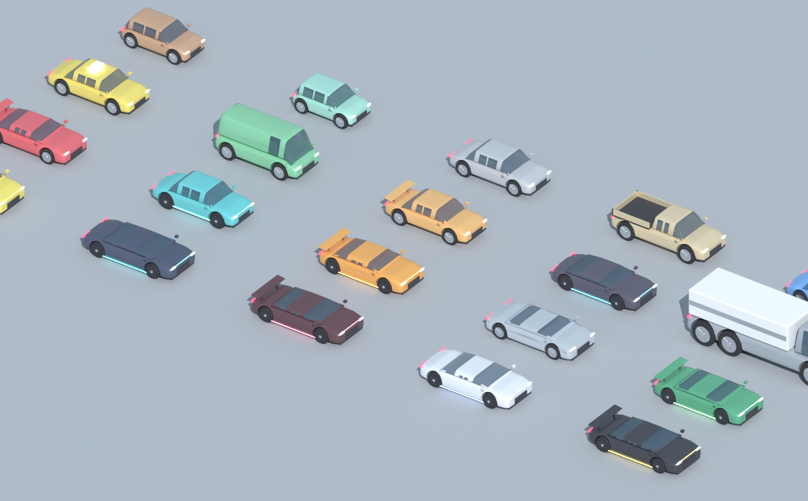

# CAR HUNTERS

Roblox-игра: бегай по опасным дорогам, собирай детали, бросай их в ловушку в гараже — получай машины.

## Что внутри

| Путь | Что это |
|---|---|
| `CarHunters.rbxlx` | **Готовый плейс** — открыть в Roblox Studio |
| `src/` | Все скрипты (структура = дерево Explorer). Источник правды для кода |
| `base/CarHunters_original.rbxlx` | Исходный плейс (до изменений) |
| `tools/build_place.py` | Собирает `CarHunters.rbxlx` из `base/` + `src/` |
| `blender/make_cars.py`, `blender/make_props.py` | Генераторы 3D-моделей в Blender |
| `assets/cars/*.fbx`, `assets/props/props.fbx` | Готовые модели машин и пропсов |
| `docs/renders/` | Рендеры моделей из Blender |
| `docs/figma/` | Скриншот макета UI |

Пересборка плейса после правки скриптов: `python3 tools/build_place.py`.

## UI (Figma → Luau)

Макет: **https://www.figma.com/design/J1YivVRVzpzEBhV6d5qPe4** (HUD, телепорт, выбор приманки, получение машины, экран WRECKED, мобильная раскладка, UI-кит).
Код: `src/StarterPlayer/StarterPlayerScripts/Client/UI.lua`.

- Шрифты: **Luckiest Guy** (заголовки, кнопки) + **Fredoka One** (текст).
- Палитра: жёлтый / оранжевый / красный / зелёный / голубой, чёрная обводка. **Фиолетового нет** (редкость Epic теперь красно-розовая).
- Минимум кнопок: справа 3 большие — **TELEPORT**, **GARAGE**, **CARS**. Кнопка **THROW!** появляется только у своей ловушки.
- Телепорт: «Мой гараж» + все открытые районы; закрытые районы открываются прямо в этом окне. С добычей в рюкзаке телепорт домой запрещён — её надо донести ногами (иначе пропадает риск).

## Карта

- Меньше и понятнее: 460 × 1490 studs (было 600 × 1940), 4 района по ~250 studs, 8 гаражей.
- **Ускоряющие дорожки** (оранжевые с бегущими шевронами): центральная аллея площади, дорожки от каждого гаража к центру и в каждом квартале между дорогами. Скорость 18 → 48, лёгкий FOV-эффект. Через дороги не проходят.
- Дороги опаснее: везде 2 полосы в каждую сторону, скорость выше (город 30–44, трасса 52–70, промзона 42–60, неон 68–90), плотнее поток и «волны» — полоса периодически разгоняется и тормозит.
- **Касание машины = мгновенная смерть** и потеря **всей** добычи текущего забега. Сохранённые машины, деньги и детали в гараже не теряются. Удар засчитывается по тому, что видит игрок (клиент сообщает, сервер перепроверяет по своему времени), плюс серверная проверка как страховка.
- Мультяшный стиль: гладкие материалы, яркая палитра, клетчатая финишная арка, припаркованные машины, стопки покрышек, витрина легендарных машин на вращающихся подиумах.

## Анимации

- **Бросок детали** (`TrapFx.lua`): кинокамера, леттербокс, деталь летит со шлейфом, удар + шоквейв, зарядка ловушки (кольца, нарастающая тряска, зум), взрыв со вспышкой, глитчем, лучом цвета редкости; машина выезжает из портала, камера облетает её. Сила эффектов растёт с редкостью; Epic/Legendary — надпись на весь экран, Legendary — золотой салют.
- **Получение машины**: карточка с вращающимися лучами, 3D-моделью, редкостью и доходом.
- **Смерть** (`DeathFx.lua`): красная вспышка, сильная тряска, RGB-глитч, обесцвечивание, «WRECKED!», список потерянного, камера-кран над местом аварии, отсчёт до респавна.
- Инструменты в `CineFx.lua`: тряска, зум, затемнение, леттербокс, глитч, титры.

## Дым из глушителя (`ExhaustFx.lua`)

| Редкость | Эффект |
|---|---|
| Common | тонкий серый дым |
| Uncommon | плотнее, зеленоватый |
| Rare | голубой дым + искры, 2 трубы |
| Epic | красное пламя + тёмный дым + искры, хлопки |
| Legendary | золотое пламя, светящийся дым, искры, свет, хлопки |

## 3D-модели из Blender — один ручной шаг

Модели сгенерированы скриптом `blender/make_cars.py` (лофт кузова по сечениям, остеклённая кабина со стойками, вырезанные арки, диски со спицами, фары, бамперы, спойлеры, неон). 20 коллекционных (~12k треугольников) и 11 трафиковых в облегчённом LOD (~7.5k).



Roblox не позволяет вшить меши в `.rbxlx` без загрузки в ваш аккаунт, поэтому импорт делаете вы (бесплатно):

1. Studio → **Home → Import 3D** → `assets/cars/cars_collection.fbx` → Import (появится в Workspace).
2. То же для `assets/cars/cars_traffic.fbx` и `assets/props/props.fbx`.
3. View → Command Bar, выполнить:
   ```lua
   require(game.ServerStorage.Tools.CarModelTool).ApplyImported()
   ```
   Скрипт сам раскладывает модели в `ReplicatedStorage.CarModels` / `CarModels.Traffic` / `ServerStorage.BuilderAssets.Props` и назначает материалы (стекло, хром, неон, фары…).
4. Проверка: `require(game.ServerStorage.Tools.CarModelTool).Preview()` — если машины смотрят назад, поставьте модели атрибут `Yaw = 180`.
5. Сохраните плейс.

Пока модели не импортированы, игра работает на процедурных машинах (как раньше).

## Проверка в Studio

1. Открыть `CarHunters.rbxlx`, Game Settings → Security → *Enable Studio Access to API Services* (для сохранений).
2. Play: карта строится при старте сервера. В Output — `[BuildCityMap] done` и `[CarHunters] server ready`, ошибок быть не должно.
3. Test → Clients and Servers → 2+ игрока: разные гаражи, телепорты, смерть от машины, бросок детали.
4. Device Emulator (телефон): кнопки не перекрывают джойстик и прыжок.

## Отчёт по итерации

```text
СДЕЛАНО:
- UI по макету Figma: HUD, телепорт (с открытием районов), гараж, коллекция, выбор приманки, получение машины, тосты
- Телепорт на сервере (WarpService): проверки зоны, кулдаун, запрет телепорта домой с добычей
- Карта: компактнее, ускоряющие дорожки, мультяшный стиль, автомобильный декор, без фиолетового
- Трафик: 2+2 полосы, выше скорость и плотность, «волны»; касание = смерть и потеря всей добычи забега
- Кинематографичные анимации броска, выпадения машины и смерти
- Дым/пламя из глушителя по редкости
- 31 модель машин + 3 пропса из Blender, инструмент импорта

ПРОВЕРЕНО:
- Синтаксис всех Luau-скриптов (парсер StyLua, режим Luau)
- Модели: генерация и экспорт FBX в Blender 5.1, рендеры
- Сборка .rbxlx

НЕ ПРОВЕРЕНО / РИСКИ:
- Запуск в Roblox Studio (здесь Studio недоступен) — нужен Play-тест
- Ориентация моделей после Import 3D (исправляется атрибутом Yaw)
- Баланс сложности трафика — подстроить скорости в MapConfig.Roads после плейтеста
- FPS на слабых телефонах с меш-трафиком

ЧТО НУЖНО ОТ ПОЛЬЗОВАТЕЛЯ:
- Один раз импортировать 3 FBX и выполнить ApplyImported (см. выше)
- Play-тест и обратная связь
```
